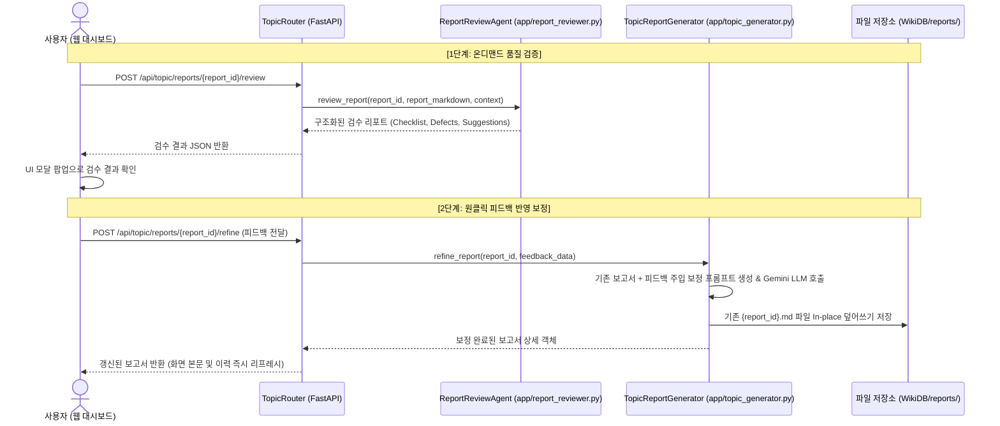

# AI 보고서 품질 검수 에이전트 및 온디맨드 보정 루프 설계 문서

## 1. 개요 및 목적
본 문서는 LLMwiki 시스템에서 생성된 AI 기반 주제별 보고서의 신뢰성과 완성도를 비약적으로 향상시키기 위해, 전문 감수 에이전트(`ReportReviewAgent`)를 통한 **온디맨드 품질 감사(Audit & Review)** 및 사용자 승인 기반 **피드백 반영 보정 루프(Refinement Loop)**를 설계한다.

### 핵심 목표
1. **단일 패스 생성의 한계 극복**: 1차 생성 시 간혹 발생하는 필수 표 누락, 정량 수치(CAGR, 억 달러 등) 미흡, 출처 규격 오류를 사후 검출하고 정밀 보정.
2. **온디맨드 휴먼 인 더 루프(Human-in-the-Loop)**: 매 생성마다 LLM을 3회 강제 호출하여 발생하는 속도 저하(35초 이상 지연)를 방지하고, 사용자가 필요할 때만 [AI 품질 검증] 버튼을 눌러 감수 결과를 확인하고 원클릭으로 보정 반영.
3. **단일 진실원 유지(In-place Update)**: 보정 완료 시 파일 버전을 분리하지 않고 기존 보고서 파일(`WikiDB/reports/{report_id}.md`)을 직접 덮어쓰기 갱신하며, 점수(Score) 등 불필요한 메타데이터는 배제하고 깔끔한 상태를 유지.

---

## 2. 전체 시스템 아키텍처 및 데이터 흐름



---

## 3. 백엔드 상세 설계

### 3.1. `ReportReviewAgent` (`app/report_reviewer.py` 신규)
보고서 본문과 원본 검색 컨텍스트를 입력받아 5대 기준으로 정밀 검수하고 구조화된 JSON 결과를 반환한다.

#### 5대 감수 평가 항목
1. **5대 목차 준수도 (`structure_valid`)**: `1. 기술개요`, `2. 기술동향`, `3. 시장동향 (국내/세계시장 규모 데이터)`, `4. 주요업체`, `5. 데이터 출처`의 순서 및 헤딩 고정 여부.
2. **3대 핵심 비교 표 구비 (`tables_valid`)**: 2장(기술 비교표), 3장(시장 전망표), 4장(기업 비교표) 중 누락된 표가 있는지 확인.
3. **정량 데이터 충실도 (`quantitative_data_valid`)**: 컨텍스트에 포함된 수치(연도, 억 원/달러, CAGR %, 공정 nm, 대역폭 등)의 충실한 인용 여부.
4. **시각 자산 결합 (`images_valid`)**: 유의미한 아키텍처 다이어그램 및 시장 차트 이미지의 인라인 단독 행 배치 여부.
5. **전문 어조 및 AI 상투어 배제 (`tone_valid`)**: 서두/말미의 인사말 및 안내 문구 배제, 단정적 보고서 문체(~다, ~이다) 유지 여부.

#### JSON 출력 스키마
```json
{
  "passed_all": false,
  "checklist": {
    "structure_valid": true,
    "tables_valid": false,
    "quantitative_data_valid": true,
    "images_valid": true,
    "tone_valid": true
  },
  "defects": [
    "2. 기술동향에 핵심 기술 방식 비교 요약 표(Markdown Table)가 누락되었습니다.",
    "3. 시장동향에 연도별 시장 규모 및 CAGR 전망 데이터 표가 누락되었습니다."
  ],
  "actionable_suggestions": [
    "컨텍스트에 제공된 세부 기술 방식을 비교하는 마크다운 표를 2장에 삽입하십시오.",
    "컨텍스트의 연도별 시장 규모(억 달러) 및 CAGR 수치를 3장 표로 구성하십시오."
  ]
}
```

### 3.2. `TopicReportGenerator.refine_report` (`app/topic_generator.py` 확장)
- 기존에 저장된 보고서 마크다운을 로드하고, 리뷰어 에이전트의 `defects`와 `actionable_suggestions`를 주입하여 Gemini LLM(`gemini-2.5-flash`)을 통해 보정본을 생성한다.
- **보정 원칙**:
  - 기존의 잘 작성된 문단과 구조는 그대로 보존.
  - 지적된 결함(누락된 표, 정량 데이터 보완 등)만을 집중 보강.
  - 사용자의 요구에 따라 점수(XX점 등) 표기는 완전히 배제.
  - 생성 완료 후 `save_report`와 유사하게 출처 중복 제거 정규화를 거친 뒤, **동일한 `report_id.md` 경로에 덮어쓰기(In-place Update)**.

### 3.3. 라우터 엔드포인트 (`app/topic_router.py` 확장)
- `POST /api/topic/reports/{report_id}/review`:
  - 파라미터: `report_id` (경로 변수)
  - 응답: `ReviewResultResponse` (체크리스트, 결함 목록, 개선 제안)
- `POST /api/topic/reports/{report_id}/refine`:
  - 파라미터: `report_id` (경로 변수), 요청 바디: `RefineRequest` (피드백 데이터 포함)
  - 응답: `TopicReportItemResponse` (보정 및 덮어쓰기 완료된 보고서 상세 데이터)

---

## 4. 프론트엔드 UI/UX 상세 설계

### 4.1. 상단 툴바 액션 버튼 (`app/static/index.html`)
- 보고서 뷰어 상단 툴바의 `MD 복사`, `MD 다운로드` 좌측에 배치:
  ```html
  <button id="btnReviewReport" class="px-2.5 py-1.5 text-xs rounded-lg bg-amber-600/80 hover:bg-amber-600 text-white transition flex items-center gap-1.5 shadow-md cursor-pointer active:scale-95">
    <i class="fa-solid fa-magnifying-glass-chart" id="reviewIcon"></i>
    <span id="reviewBtnText">AI 품질 검증</span>
  </button>
  ```

### 4.2. 품질 검증 결과 모달 (`reportReviewModal`)
- 모달 헤더: `🔍 AI 보고서 품질 및 사실 검증 결과`
- 5대 체크리스트 시각화:
  - 5대 표준 목차 준수 (Pass/Fail 배지)
  - 3대 핵심 비교 표 구비 (Pass/Fail 배지)
  - 정량 데이터 및 단위 충실도 (Pass/Fail 배지)
  - 다이어그램/차트 이미지 결합 (Pass/Fail 배지)
  - 전문 보고서 어조 및 AI 상투어 배제 (Pass/Fail 배지)
- 상세 피드백 영역: 리뷰어가 발견한 구체적 결함 및 개선 권고사항 카드
- 하단 버튼:
  - `[✨ 피드백 반영하여 보고서 개선]`: 클릭 시 보정 API 비동기 호출 및 로딩 스피너 표시
  - `[닫기]`: 모달 닫기

### 4.3. 화면 즉시 리프레시 로직 (`app/static/app.js`)
- 보정 API 완료 시:
  1. 모달 팝업 자동 닫힘
  2. 현재 열람 중인 보고서 뷰어(`topicRenderedContent`)의 본문 마크다운 즉시 교체
  3. 우측 최근 생성 이력 리스트의 해당 항목 즉시 최신화
  4. 상단에 "보고서가 성공적으로 보정되었습니다." 토스트 알림 표출

---

## 5. 검증 및 테스트 계획

### 5.1. 단위 테스트 (`tests/test_report_reviewer.py` 신규)
- 결함이 있는 마크다운(표 누락, 목차 누락 등)을 주입했을 때 리뷰어의 룰 및 LLM 파서가 결함을 정확히 탐지하는지 검증.
- 유효한 JSON 포맷 파싱 및 fallback 구조 검증.

### 5.2. 통합 테스트 (`tests/test_topic_system.py` 확장)
- `POST /api/topic/reports/{report_id}/review` 엔드포인트 호출 검증.
- `POST /api/topic/reports/{report_id}/refine` 호출 시 파일 내용이 In-place 덮어쓰기되고, 점수 표기 없이 개선되는지 검증.

### 5.3. 전체 회귀 테스트
- `.venv\Scripts\pytest` 전체 테스트 스위트 실행을 통해 기존 인제스트, 위키 에이전트, 서버 엔드포인트 무결성 최종 확인.
